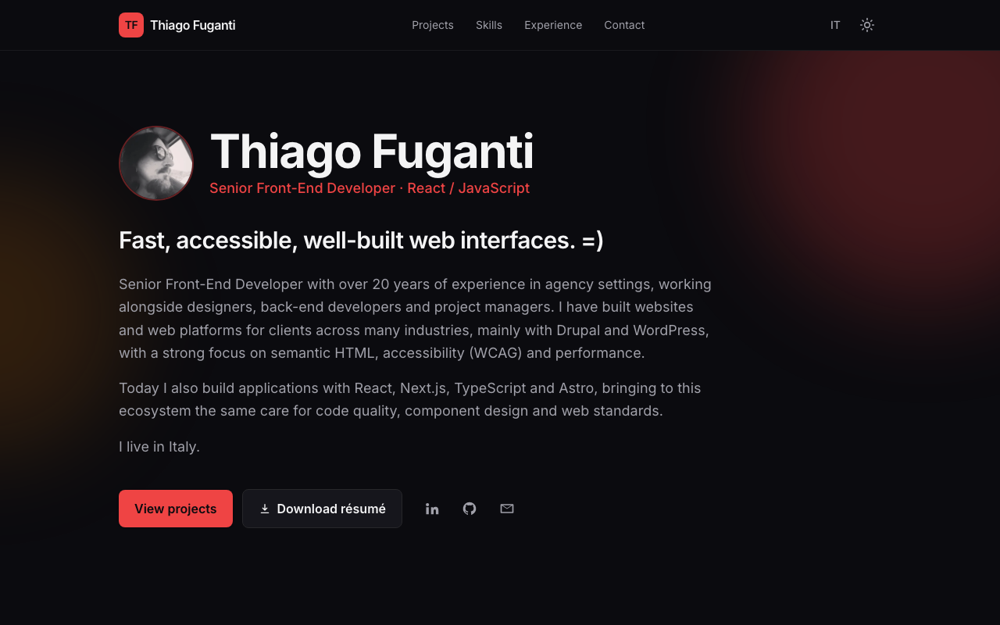
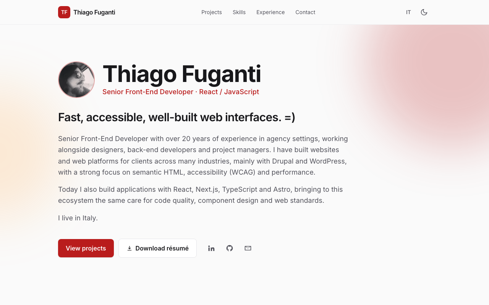
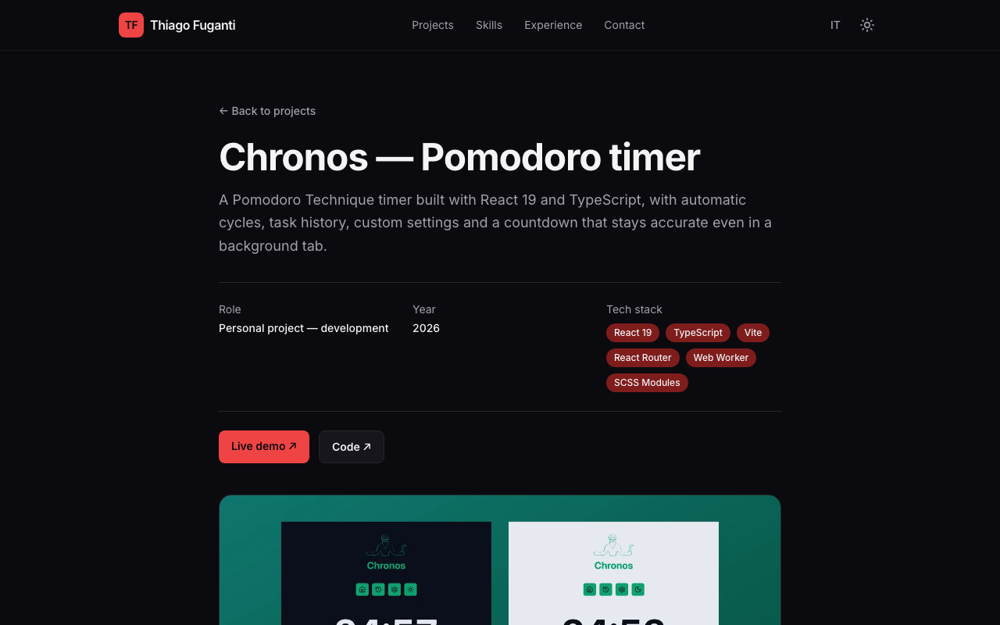
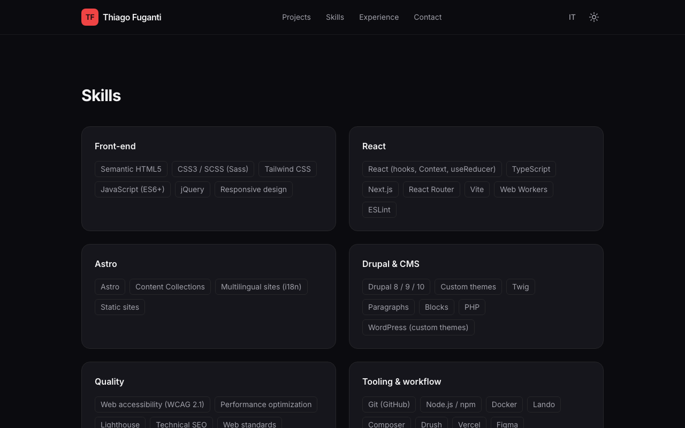
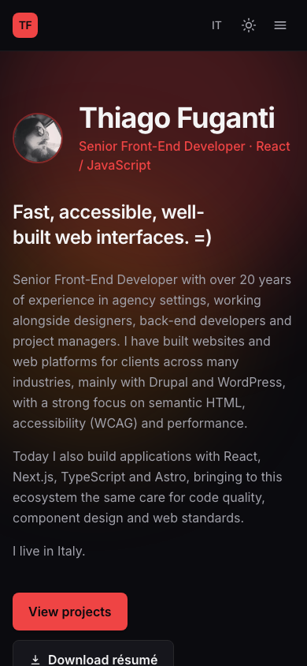

# Thiago Fuganti — Portfolio

My personal portfolio: a fast, accessible static site that presents who I am, the projects I have built and my experience as a Senior Front-End Developer. It is available in Italian and English, with light and dark themes.

Built with Astro and Tailwind CSS.

<p align="center">
  
  
</p>

## Features

- **Two languages**: Italian at the root and English under `/en/`, with a language switch that keeps you on the same page.
- **Case studies**: each project has its own page with role, year, tech stack, links to the live site and code, screenshots and a "next project" link.
- **Content in Markdown**: projects live in content collections, validated by a schema, so adding one is just adding a file.
- **Light and dark themes**: follows the system setting and remembers the visitor's choice.
- **SEO ready**: canonical URLs, `hreflang` alternates, Open Graph and Twitter tags, sitemap and `robots.txt`.
- **Accessible**: semantic HTML, skip link, visible focus styles, keyboard-friendly mobile menu and reduced-motion support.
- **Responsive**: designed for phones first, from 390px up.
- **No client framework**: pages ship as static HTML, with only a few lines of JavaScript for the theme toggle and the mobile menu.

## Screenshots

| Case study | Skills | Mobile |
| --- | --- | --- |
|  |  |  |

## Tech stack

| Area | Tools |
| --- | --- |
| Framework | Astro 7, TypeScript |
| Styles | Tailwind CSS 4 (Vite plugin), `@tailwindcss/typography` |
| Content | Astro content collections with a Zod schema |
| i18n | Astro i18n routing (`it` default, `en`) |
| SEO | `@astrojs/sitemap`, Open Graph and `hreflang` tags |
| Font | Inter Variable via `@fontsource-variable/inter` |

## How it works

Every text on the site comes from three places: `src/data/profile.ts` holds the profile and the localized copy (role, intro, skills, experience), `src/i18n/ui.ts` holds the interface labels, and `src/content/projects/` holds the case studies as Markdown, one folder per language.

Both languages render the same components. `HomePage.astro` and `ProjectPage.astro` receive a `lang` prop, and thin route files under `src/pages/` pick the language. Project files share the same name in `it/` and `en/`, which is how the language switch finds the matching page.

Theme colors are CSS variables on `:root` and `.dark`, exposed to Tailwind through `@theme inline`, so changing the accent color is a one-line edit.

```
src/
├── components/    Header, Hero, HomePage, ProjectPage, ProjectCard, Contact, ...
├── content/       projects/it and projects/en case studies (Markdown)
├── data/          profile.ts: profile and localized copy
├── i18n/          ui.ts: interface labels and path helpers
├── layouts/       Layout.astro: head, SEO tags, theme script
├── lib/           project queries
├── pages/         routes for Italian (/, /progetti/) and English (/en/)
└── styles/        global.css: Tailwind setup and theme tokens
```

## Running locally

Requires Node.js 22.23.4 or newer. The project is developed on Node 23.

```bash
git clone https://github.com/aversvs/portfolio-thiago-fuganti.git
cd portfolio-thiago-fuganti
npm install
npm run dev
```

| Script | What it does |
| --- | --- |
| `npm run dev` | Starts the dev server on `http://localhost:4321` |
| `npm run build` | Builds the static site to `dist/` |
| `npm run preview` | Serves the production build |

## Editing content

| What | Where |
| --- | --- |
| Name, email, social links, photo, résumé | `src/data/profile.ts` (`profile`) |
| Role, intro, skills, experience, languages, education | `src/data/profile.ts` (`content`) |
| Interface labels (buttons, section titles) | `src/i18n/ui.ts` |
| Projects and case studies | `src/content/projects/it/*.md` and `en/*.md` |
| Theme colors | `src/styles/global.css` (`:root` and `.dark`) |
| Site domain | `astro.config.mjs` (`site`) and `public/robots.txt` |

To add a project, create a Markdown file with the same name in `src/content/projects/it/` and `src/content/projects/en/`, fill in the front matter (`title`, `summary`, `cover`, `coverAlt`, `tags`, `role`, `year`, `demo`, `repo`, `order`) and put the images in `public/projects/`. The `order` field sets the position on the home page.

To show a contact form next to the email button, create a free form on [Formspree](https://formspree.io) and set its URL in `formEndpoint` in `profile.ts`.

The résumé (`public/cv.pdf`) is not tracked in git. Add it locally or upload it to the host before deploying.
